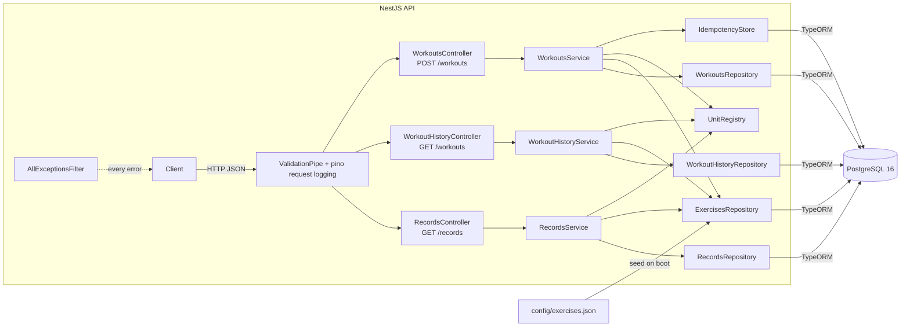

# Everfit Workout Logging API

API for coaches to log client workouts and track history and personal records (PRs).
Built with NestJS, PostgreSQL 16 and TypeORM.

## Requirements

- Docker with Compose v2 (enough to run the API)
- Node.js 20 and npm (only for local development and tests)

## Getting started

```bash
docker compose up --build
```

- API: http://localhost:3000
- OpenAPI docs: http://localhost:3000/docs (JSON at `/docs-json`)
- Postgres is exposed on host port **5433** (to avoid clashing with a local 5432)

Migrations and the exercise catalog seed run automatically on boot.

### Try it

Log a workout (sending the same `Idempotency-Key` again replays the first response with `Idempotent-Replayed: true`):

```bash
curl -s -X POST localhost:3000/users/client-42/workouts \
  -H 'content-type: application/json' \
  -H 'Idempotency-Key: 7d3c1c2e-demo-0001' \
  -d '{
    "entries": [
      {
        "exerciseName": "Bench Press",
        "date": "2026-11-16T07:30:00+07:00",
        "sets": [
          { "reps": 5, "weight": 100, "unit": "kg" },
          { "reps": 3, "weight": 225, "unit": "lb" }
        ]
      }
    ]
  }'
```

Browse history (partial name match, weights converted to lb):

```bash
curl -s 'localhost:3000/users/client-42/workouts?exercise=bench&unit=lb&limit=20'
```

Personal records, all time and this month vs last month:

```bash
curl -s 'localhost:3000/users/client-42/records?exercise=Bench%20Press'
curl -s 'localhost:3000/users/client-42/records?exercise=Bench%20Press&from=2026-11-01&to=2026-11-30&compareFrom=2026-10-01&compareTo=2026-10-31'
```

An unsupported unit returns `400` with `VALIDATION_FAILED` and the field path `entries[0].sets[0].unit`.

### Local development

```bash
cp .env.example .env
docker compose up -d db
npm ci
npm run start:dev
```

### Tests

```bash
npm test            # unit tests (67)
npm run test:int    # integration tests against a throwaway Postgres 16 via Testcontainers (48) — needs Docker
npm run lint
```

## Architecture



```
src/
├── common/      error model + global filter, date parsing, validators, decimal math
├── config/      Joi env validation
├── database/    TypeORM entities, migration, pg type parsers
├── units/       UnitRegistry (kg, lb) — DI provider
├── exercises/   exercise catalog, name normalization, seeder
├── workouts/    POST bulk logging, idempotency, GET history
├── records/     personal records + period comparison
└── health/      GET /health
```

Each feature module owns its controller → service → repository. Pure logic (date parsing, cursor codec,
PR shaping, decimal multiplication) lives in plain functions with unit tests; anything touching SQL is
covered by integration tests against real Postgres.

## API

No authentication; `userId` is a path parameter (`[A-Za-z0-9_-]{1,64}`).

### `POST /users/:userId/workouts` — log one or more exercises

Optional header `Idempotency-Key` (1–255 chars).

```json
{
  "entries": [
    {
      "exerciseName": "Bench Press",
      "date": "2026-11-16T07:30:00+07:00",
      "sets": [{ "reps": 5, "weight": 225, "unit": "lb" }]
    }
  ]
}
```

- `date`: `YYYY-MM-DD`, or an ISO 8601 datetime **with an explicit offset** (`Z` or `±HH:MM`). Offset-less datetimes are rejected. At most 24h in the future.
- `entries` 1–100, `sets` 1–50 per entry, `reps` integer 1–1000, `weight` 0–2000 with ≤ 2 decimals, `unit` ∈ `kg | lb`.
- All-or-nothing: one invalid item rejects the whole batch.

`201 Created`

```json
{
  "data": [
    {
      "id": "01a1e526-fcdc-733f-aea8-e93f0f254581",
      "exerciseName": "Bench Press",
      "performedAt": "2026-11-16T00:30:00.000Z",
      "localDate": "2026-11-16",
      "utcOffsetMinutes": 420,
      "sets": [{ "reps": 5, "weight": 225, "unit": "lb", "weightKg": 102.06 }]
    }
  ]
}
```

Replaying the same `Idempotency-Key` with the same body returns the stored response and header
`Idempotent-Replayed: true` without writing again; with a different body it returns `422`.

### `GET /users/:userId/workouts` — history

| Query | Notes |
|---|---|
| `exercise` | partial, case-insensitive (`bench` matches "Bench Press", "Incline Bench Press") |
| `muscleGroup` | e.g. `legs`, from the configurable catalog |
| `from`, `to` | `YYYY-MM-DD`, inclusive, on the client's local date |
| `unit` | `kg` (default) or `lb` |
| `limit` | 1–100, default 20 |
| `cursor` | opaque, from `meta.nextCursor` |

```json
{
  "data": [
    {
      "id": "…",
      "exerciseName": "Bench Press",
      "muscleGroups": ["chest", "triceps", "shoulders"],
      "performedAt": "2026-11-16T00:30:00.000000Z",
      "localDate": "2026-11-16",
      "utcOffsetMinutes": 420,
      "sets": [{ "reps": 5, "weight": 225, "unit": "lb", "originalWeight": 225, "originalUnit": "lb" }]
    }
  ],
  "meta": { "limit": 20, "nextCursor": "WyIyMDI2LTExLTE2Ii…" }
}
```

No matches → `200` with `data: []` and `meta.message: "No workouts found for the given filters"`.

### `GET /users/:userId/records` — personal records

| Query | Notes |
|---|---|
| `exercise` | required, exact name (case/spacing-insensitive) |
| `unit` | `kg` (default) or `lb` |
| `from`, `to` | optional period; omit both for all-time |
| `compareFrom`, `compareTo` | optional second period (requires `from`/`to`) |

```json
{
  "data": {
    "exercise": "Bench Press",
    "unit": "kg",
    "current": {
      "from": "2026-11-01", "to": "2026-11-30",
      "maxWeight": { "value": 105, "weight": 105, "reps": 5, "date": "2026-11-03" },
      "maxVolume": { "value": 525, "weight": 105, "reps": 5, "date": "2026-11-03" },
      "bestE1rm":  { "value": 122.5, "weight": 105, "reps": 5, "date": "2026-11-03" }
    },
    "previous": { "from": "2026-10-01", "to": "2026-10-31", "…": "…" },
    "delta": { "maxWeight": -5, "maxVolume": 25, "bestE1rm": 5.17 }
  }
}
```

- `maxWeight`: heaviest single set; `maxVolume`: max `reps × weight`; `bestE1rm`: max Epley `weight × (1 + reps/30)`.
- Ties go to the **earliest** set. Exercise in catalog but no sets in period → metrics `null` + `message`. Unknown exercise → `404`.

### `GET /health`

`{"status":"ok"}` or `503` if the database is unreachable.

### Errors

Every error has the same shape; `requestId` matches the `X-Request-Id` response header and log lines.

```json
{
  "error": {
    "code": "VALIDATION_FAILED",
    "message": "Request validation failed",
    "details": [{ "path": "entries[1].sets[0].weight", "message": "weight must not be less than 0" }]
  },
  "requestId": "69bd5ee6-e1f8-48e8-88cb-e016b78f4e57"
}
```

| Status | Code | When |
|---|---|---|
| 400 | `VALIDATION_FAILED` | any body/query/param/header validation failure, including unsupported units |
| 400 | `INVALID_CURSOR` | cursor cannot be decoded |
| 400 | `BAD_REQUEST` | malformed JSON |
| 404 | `EXERCISE_NOT_FOUND` | records for an exercise not in the catalog |
| 404 | `NOT_FOUND` | unknown route |
| 413 | `PAYLOAD_TOO_LARGE` | body over 1 MB |
| 422 | `IDEMPOTENCY_KEY_REUSED` | same key, different body |
| 500 | `INTERNAL_ERROR` | unexpected; details logged, never returned |
| 503 | `SERVICE_UNAVAILABLE` | health check cannot reach the database |

## Database design

### Why PostgreSQL

PR queries are "max over individual sets" with tie-breaking and date filters. A relational `workout_sets`
table with B-tree indexes answers each PR with one index probe. Postgres also gives generated columns,
`pg_trgm` for partial name search, real transactions for all-or-nothing bulk writes, and unique-index
semantics for idempotency. With MongoDB and sets embedded in entries, every PR query needs `$unwind`
over the user's whole history.

### Tables

| Table | Purpose |
|---|---|
| `exercises` | catalog: `name`, `normalized_name` (unique, lowercase/trimmed), `muscle_groups text[]` |
| `workout_entries` | one row per logged exercise: `user_id`, `exercise_id`, `performed_at timestamptz`, `local_date date`, `utc_offset_minutes` |
| `workout_sets` | one row per set: `reps`, original `weight` + `unit`, normalized `weight_kg`; generated `volume_kg`, `e1rm_kg`; `user_id`, `exercise_id`, `local_date`, `performed_at` denormalized from the entry |
| `idempotency_keys` | `(user_id, key)` PK, request hash, stored status + response body |

- Weights are `numeric` with unbounded scale. Conversion to kg uses exact decimal multiplication (BigInt over decimal strings), so `225 lb` is stored as exactly `102.05828325` kg. Display values are rounded to 2 decimals; when the requested unit equals the logged unit the original value is returned untouched.
- `volume_kg` and `e1rm_kg` are `GENERATED ALWAYS … STORED`. The e1RM expression uses `reps / 30.0` — with integer `reps`, `reps / 30` would be integer division and always 0.
- Sets carry denormalized `user_id`, `exercise_id`, `local_date`, `performed_at` so PR queries never join.
- IDs are UUIDv7 generated in the app (time-ordered, no dependency on insert order).
- Entities mirror the hand-written migration (`synchronize: false`); generated columns are declared with `generatedType: 'STORED'` and `insert/update: false`.

### Indexes and the query each one serves

| Index | Serves |
|---|---|
| `workout_entries (user_id, local_date DESC, performed_at DESC, id DESC)` | history pages, date-range filters, keyset cursor |
| `workout_entries (user_id, exercise_id, local_date DESC, performed_at DESC, id DESC)` | history filtered to one exercise |
| `workout_sets (user_id, exercise_id, weight_kg DESC, performed_at, id)` | all-time heaviest set |
| `workout_sets (user_id, exercise_id, volume_kg DESC, performed_at, id)` | all-time max volume |
| `workout_sets (user_id, exercise_id, e1rm_kg DESC, performed_at, id)` | all-time best e1RM |
| `workout_sets (user_id, exercise_id, local_date) INCLUDE (…)` | PRs within a sparse date range |
| `workout_sets UNIQUE (entry_id, set_index)` | loading sets for a page of entries; set order |
| `exercises GIN (normalized_name gin_trgm_ops)` | `LIKE '%bench%'` partial search |

## Key decisions and trade-offs

**Timezone.** Clients send `date` with an explicit offset. We store `performed_at` in UTC plus the
client's `local_date` and offset. Date filters and "this month vs last month" use `local_date`, so a
23:00 session in UTC+7 stays on the right day. Trade-offs: a user who travels keeps the local date of
where they trained, which matches how people think about workouts; storing only UTC would shift days for
anyone far from UTC. Date-only input (`2026-11-16`) is accepted as a calendar date with `performed_at`
at 00:00Z and no offset. A per-user timezone setting would remove the need for clients to send offsets.

**PRs computed on read.** No precomputed PR table, so no write-time locking, no drift when entries are
edited or deleted, and period comparison uses the same query. Each PR is one `ORDER BY … LIMIT 1` index
probe.

**Epley.** Applied literally as specified, `weight × (1 + reps/30)`, including `reps = 1`
(→ 1.033 × weight). A common convention treats a 1-rep set as its own 1RM; that is a one-line change in
the generated column if the product prefers it.

**Concurrency.** Two simultaneous logs of the same exercise create two independent entries; nothing is
shared and mutated. New exercise names are inserted sorted, with `ON CONFLICT DO NOTHING`, in their own
short statement, then re-read: sorting prevents deadlocks between batches naming exercises in opposite
order, and the re-read is needed because `RETURNING` yields nothing for skipped rows. Duplicate submits
from retries are handled with `Idempotency-Key`: the key row is inserted first inside the write
transaction (READ COMMITTED); a concurrent duplicate waits on the unique index, then replays the stored
response. Tested with 20 parallel writers and 5 parallel same-key requests.

**Bulk writes.** One transaction per request; entries via one `INSERT`, sets in chunks of 1,000 rows
(~11k bind parameters, under Postgres' 65,535 limit). The 1 MB JSON limit fits the 100 × 50 maximum.

**Extensibility.** New unit: add `stone: '6.35029318'` to `src/units/units.config.ts`; validation,
conversion and Swagger pick it up, no migration. Muscle groups: edit `config/exercises.json`; the seeder
upserts on boot (`ON CONFLICT … DO UPDATE`), no code change.

**TypeORM.** Entities + Repository/QueryBuilder for all data access. The keyset condition
`(local_date, performed_at, id) < (…)` is a raw fragment inside QueryBuilder because there is no
row-comparison API. Cursor timestamps are read with `to_char(… 'US')` since JS `Date` drops
microseconds and would skip or repeat rows. node-postgres is configured to return `date` columns as
strings so `local_date` is never shifted by the server timezone.

**No Kafka.** Nothing slow happens after a write, and an async pipeline would make PRs stale right after
logging. See "At scale" for when a broker becomes worth it.

## At scale

- Partition `workout_sets`/`workout_entries` by hash of `user_id` once tables reach hundreds of millions of rows.
- Read replicas for history/records; writes stay on the primary.
- Transactional outbox → broker (Kafka/SQS) when other consumers appear: "new PR" notifications, coach dashboards, leaderboards.
- Materialize all-time PRs per (user, exercise) if read volume dominates, updated from the outbox consumer.
- TTL cleanup job for `idempotency_keys` (e.g. 24h).
- Per-user timezone in a profile table.
- Authentication and coach→client authorization instead of trusting `userId`.

## Estimate (written before implementation, 2026-11-16)

| Block | Hours |
|---|---|
| Scaffold, config, Docker, logging, error filter | 2 |
| Schema + migrations + units + exercises | 3 |
| POST bulk + idempotency | 3 |
| History + pagination | 2.5 |
| Records + compare | 2.5 |
| Integration tests | 2.5 |
| Swagger | 1 |
| Seed + benchmark + tuning | 2 |
| README, diagram, AI_WORKFLOW | 2 |
| **Total** | **~20.5** |

## AI tooling

`CLAUDE.md` and `.claude/` hold the context the AI agent works with: project rules (code style, architecture,
database, testing, git) in `.claude/rules/`, project skills (`add-endpoint`, `add-weight-unit`)
and vetted third-party skills (see `.claude/skills/THIRD_PARTY.md`) in `.claude/skills/`, and tool permissions in
`.claude/settings.json`.
